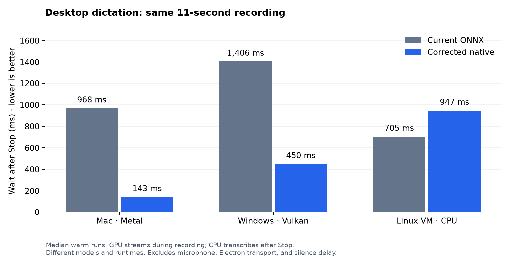
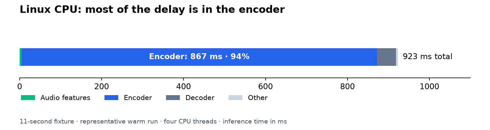

# Current versus candidate desktop voice — 2026-11-02

The comparison uses the current Parakeet TDT v3 INT8 ONNX worker and the
candidate Parakeet Unified English Q8 helper. The candidate changes both the
runtime and model. It is a product-version comparison, not a test of identical
weights in two engines. No running Solus instance or live session data was used.

## Results after corrections

Observed wait after Stop for the same 11-second English clip:

| Device and backend | Current ONNX v3 | Corrected candidate | Runs: current / candidate |
| --- | ---: | ---: | ---: |
| Apple M4, Metal | 968 ms | 143 ms | 5 / 3 |
| i7-9700K / GTX 1070 Ti, Vulkan | 1,406 ms | 450 ms | 3 / 3 |
| i7-9700K, CPU only | 1,406 ms | 1,242 ms | 3 / 3 |
| Omarchy VM, CPU only | 705 ms | 947 ms | 5 / 3 |

Candidate GPU tests and the Linux CPU test send audio at recording speed.
The Windows CPU-only control sends audio without pacing, with inference deferred
until Stop. Current ONNX always transcribes the completed clip. All entries are
medians of warm runs. The GPU path streams; the corrected CPU path buffers and
runs whole-clip inference. CPU checks produced no partial text; GPU checks did.

The severe CPU regression was a configuration defect. After correction,
Windows CPU is slightly faster in this test. Linux warm CPU inference remains
about 242 ms slower than current ONNX. That remaining regression is real; this
benchmark does not establish why the different model/runtime pair costs more.

Long recording control, audio sent at recording speed:

| Device | Current ONNX, 120 s clip | Candidate wait after Stop |
| --- | ---: | ---: |
| Apple M4, Metal | 4,128 ms | 136 ms |
| GTX 1070 Ti, Vulkan | 21,663 ms | 585 ms |

The current entries are medians (Mac: 5, Windows: 3); each candidate long control
is one paced run. Candidate wait includes queued feeds and finalization, not
just the native finalize call. These are helper/worker measurements, excluding
Electron transport, microphone capture, text insertion, and the app's silence
threshold. With automatic stop, that silence delay adds to both versions.



## What was wrong, and what changed

The initial candidate disabled x86 SIMD for portability without shipping CPU
ISA variants. It also ran buffered streaming on CPU. The initial CPU tests were
therefore poor configurations, not evidence that native streaming must be slow.

Following Hex and its pinned Rust binding's native build:

- Build portable CPU variants and let ggml select the supported ISA at runtime.
  Both x86 test machines selected the Haswell backend. Package every backend
  module, not just the generic CPU library.
- Stream only on GPU/IGPU. CPU buffers audio and transcribes on Stop, without
  repeatedly encoding overlapping windows or building a feed backlog.
- Prewarm every streaming window shape with eight seconds of silence on GPU.
- Keep one CPU decoder thread on GPU. Preserve Solus's four-thread maximum for
  CPU inference, leaving capacity for input and rendering.
- Compile only the Vulkan tensor types used by the pinned model and omit MoE
  shaders. Pin the SPIR-V header package required by ggml; the older Vulkan SDK
  does not provide its CMake package.

Before correction, the 11-second CPU stream took about 28 s on Windows and 26 s
on Linux to compute. A paced Linux run waited 14.7 s after Stop for queued work.
Those results are retained as diagnostic data, not the final candidate result.

Buffered streaming does more total work than a whole-clip run because windows
include repeated context. Its benefit is doing that work during recording.
Post-stop wait and total compute must not be reported as the same measurement.

Sources: [Hex session setup](https://github.com/anomalyco/hex/blob/dev/src/transcription/gguf_session.rs),
[Hex build flags](https://github.com/anomalyco/hex/blob/dev/.cargo/config.toml),
and the pinned `bindings/rust/sys/build.rs` in transcribe.cpp.

## Linux follow-up: comparison with Hex

The follow-up did not find another Hex setting that reliably removes the CPU
regression. The runtime commit and Unified English model hash match Hex. Both
use optimized AVX2/FMA/F16C kernels on this VM, with OpenMP and system BLAS off.
Hex's Linux release links its CPU backend statically and uses the library's
default CPU thread count. Solus loads an ISA-specific module and caps CPU work
at four threads. The following controls tested those differences.

| Control, same 11 s fixture | Native time |
| --- | ---: |
| Four threads, direct native API | 923 ms |
| Library default threads, as Hex uses | 938 ms |
| Static build with Hex's CPU build and session settings | 877 ms |
| Clang CPU kernel module instead of GCC | 997 ms |
| F32 attention cache instead of the default | 907 ms |
| Flash attention disabled | 936 ms |
| CPU graph fusion disabled | 893 ms |
| Direct depthwise convolution disabled | 1,010 ms |

These are separate serial blocks, not paired samples. Direct API entries are
medians of five runs after an excluded warm-up. The static control uses five
helper runs, including its first inference. Its executable uses the Solus
protocol with Hex's CPU settings; this is not a benchmark of the Hex app.
It omits Vulkan because this VM exposes no compute GPU. Static linking and
default threading did not make that control faster than the original 705 ms
ONNX baseline. Neither compiler nor attention controls closed the gap.

The profiler reads the library's own stage timings. Most of the remaining
work is inside the encoder, rather than IPC, audio buffering, or finalization
bookkeeping:



The thread sweep covered 1, 2, 3, 4, 6, 8, and the library default. Four threads
were fastest in that block. There is no evidence here for raising Solus's CPU
budget or changing numerical settings. Production CPU settings remain unchanged
by this follow-up.

Later 60 s and 120 s CPU controls also did not show an advantage. Timing drift
limits those comparisons: the ONNX 11 s median moved from 705 ms in the first
report to 769 ms in the duration block and 1,130 ms in the final short recheck.
Native timings varied too. The raw data preserves all of these blocks; the
later values must not be presented as a stable speed ratio or as a new fix.

A diagnostic Parakeet v3 Q8 GGUF control took 1,043 ms; Unified English took
1,246 ms in the following block. This suggests that changing the model also
contributes to the cost. The exports and quantization differ, and VM load
changed, so this does not assign an exact cost to the model or prove either
runtime is universally faster. The v3 control model is not part of the product
change.

The VM reports eight vCPUs and a virtual VGA device `1234:1111`. It cannot test
Linux GPU streaming. The release configuration already includes Vulkan; no
measured Linux GPU result is available here. Hex's displayed model speed is
also not a Linux CPU guarantee: its own benchmark metadata says the hardware
and method behind those upstream speed figures are unknown.

Sources: [Hex Linux release build](https://github.com/anomalyco/hex/blob/dev/scripts/build-linux.sh),
[Hex CPU/GPU session settings](https://github.com/anomalyco/hex/blob/dev/src/transcription/gguf_session.rs),
[Hex model artifacts](https://github.com/anomalyco/hex/blob/dev/src/transcription/artifacts.rs),
[Hex benchmark metadata](https://github.com/anomalyco/hex/blob/dev/src/transcription/model_benchmarks.rs).
The controls, raw phase timings, compiler versions, and static-control CMake
configuration are in
[the Linux investigation data](desktop-voice-linux-investigation-2026-11-02.json).

Reproduce the direct CPU profile with Python 3.11+ and the pinned shared runtime:

```sh
python3 scripts/benchmark-transcription-cpu.py \
  --library /path/to/libtranscribe.so --model /path/to/model.gguf \
  --audio /path/to/jfk.wav --output cpu-profile.json \
  --threads 1,2,3,4,6,8,0
```

The script verifies the native ABI, registers only the CPU backend, and rotates
sessions between runs. It does not start Solus or read Solus data. `0` selects
the library default. `--kv f32`, `TRANSCRIBE_NO_FLASH=1`,
`GGML_CPU_DISABLE_FUSION=1`, and `TRANSCRIBE_CONV_NO_DIRECT_DW=1` reproduce the
individual numerical/kernel controls. Change one setting per process. These
are diagnostic switches, not production recommendations. The profiler itself
was also exercised on Omarchy with both four threads and the library default.

## Method and limits

- Baseline commit: `c4c64aff22b87a99472ea8054c911138d6352a11`.
  onnxruntime-node: 1.29.0. Its inference code, session options, and four-thread
  CPU budget are unchanged. Only model/runtime paths and function exports are
  adapted to execute the worker in standalone Node. This is not an Electron
  application benchmark.
- Native runtime: transcribe.cpp commit
  `7045d1c0fe7cee37747b2792977421d435e75fca`.
- Candidate model SHA-256:
  `4b50b6dd862bf6e346929aaf4f5eaacec003bfa3f56462d6c874b41ef2f38795`.
  Baseline model files were checked against the existing downloader's hashes
  and copied into separate test folders. No live model cache was modified.
- Audio: the public 11-second JFK WAV from whisper.cpp's `samples/jfk.wav`.
  Longer clips repeat and truncate it. This synthetic repetition tests duration
  scaling; it is not an accuracy benchmark or a representative speech corpus.
- Input: 16 kHz mono PCM, 250 ms packets. `--pace` sends them at recording speed.
  Throughput runs feed as quickly as inference accepts them. Only paced runs
  establish live partial-text delay and wait including queued feeds.
- Hardware: Apple M4 / 24 GiB; Windows i7-9700K / GTX 1070 Ti; Omarchy VM with
  eight virtual CPUs reporting i5-9300H and about 8 GiB RAM. The VM exposes no
  compute GPU. Windows GPU results use MSVC and Vulkan SDK 1.4.304.1. Earlier
  portable LLVM MinGW CPU results are diagnostic only.
- Runs were serial on each machine. Initial overlapping exploratory Mac runs
  were discarded. OS file and driver caches were warm. First-request load
  timing in a fresh helper process is not a first-install cold-start result.
  GPU graph prewarming is included in the helper's reported load time.
- Process RSS / working-set snapshots are in the raw files. They exclude GPU
  allocations and are not peak total memory. Do not infer a total-memory
  improvement from those snapshots.
- No full Solus build or interactive microphone/minimize test was run. Native
  helper compilation, loading, CPU fallback, and GPU streaming were exercised.

## Reproduce

Generate the baseline worker without changing its inference code:

```sh
bun scripts/prepare-onnx-benchmark.ts c4c64aff22b87a99472ea8054c911138d6352a11 /path/to/baseline
node /path/to/baseline/benchmark-baseline.mjs MODEL_DIRECTORY ORT_INDEX_JS AUDIO_WAV OUTPUT_JSON
```

`BENCH_DURATIONS=11` and `BENCH_REPEATS=3` restrict the baseline run.
The ORT module and model files must be for the target OS and the pinned version.
The baseline generator refuses an unexpected source shape instead of leaving
live cache paths in the test worker.

Run the native helper:

```sh
python3 scripts/benchmark-transcription.py \
  --binary /path/to/solus-transcription \
  --model /path/to/model.gguf --audio /path/to/jfk.wav \
  --output result.json --repeats 3 --durations 11 --pace \
  --expect-mode streaming
```

Use `--expect-mode buffered` for CPU fallback. Python 3.11+ is required. The
script starts and stops only its own helper. Diagnostics are saved beside JSON.
Windows tools were installed as requested; test files are under
`C:\tmp\svb-1102`. Linux test files are under `~/solus-voice-bench-1102`.

## Primary raw data

- `desktop-voice-mac-onnx-2026-11-02.json`
- `desktop-voice-mac-paced-final-2026-11-02.json`
- `desktop-voice-mac-paced-120-2026-11-02.json`
- `desktop-voice-windows-onnx-2026-11-02.json`
- `desktop-voice-windows-vulkan-final-2026-11-02.json`
- `desktop-voice-windows-cpu-final-2026-11-02.json`
- `desktop-voice-windows-paced-120-2026-11-02.json`
- `desktop-voice-linux-onnx-final-2026-11-02.json`
- `desktop-voice-linux-cpu-paced-final-2026-11-02.json`

Other files with this prefix retain initial configurations and throughput
controls. They must not replace the final paced comparisons above.
